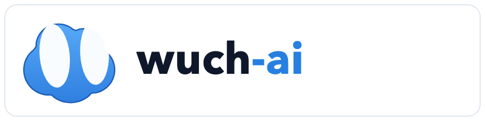
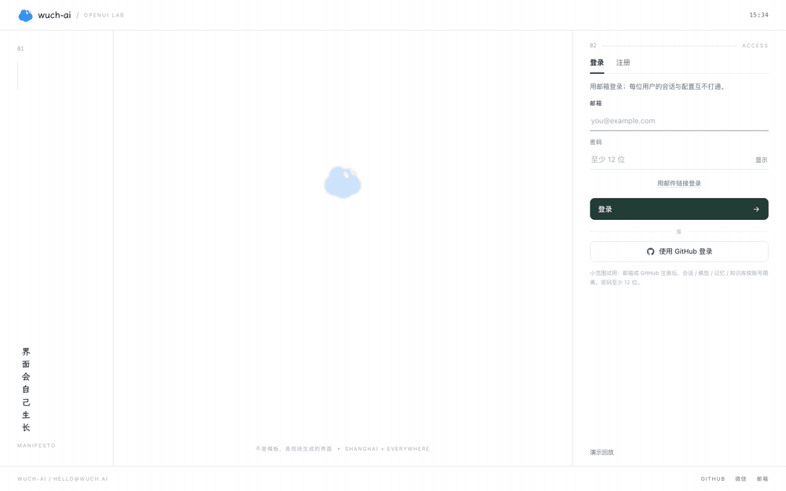
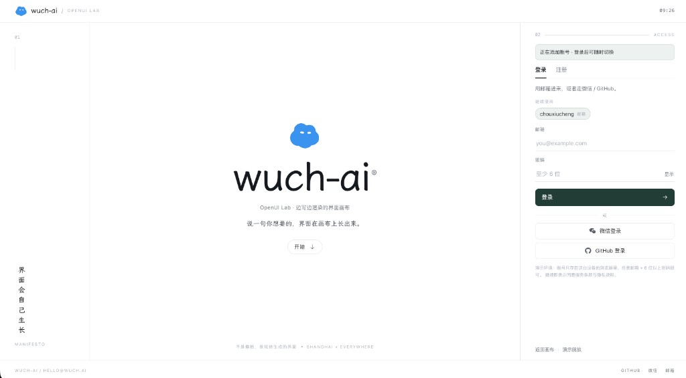
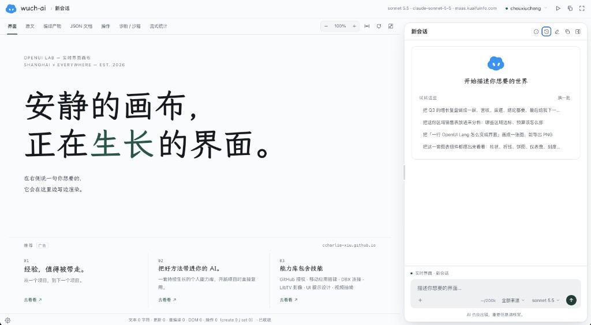
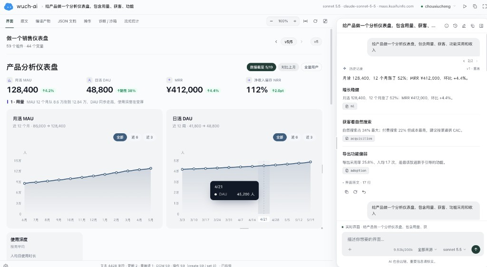
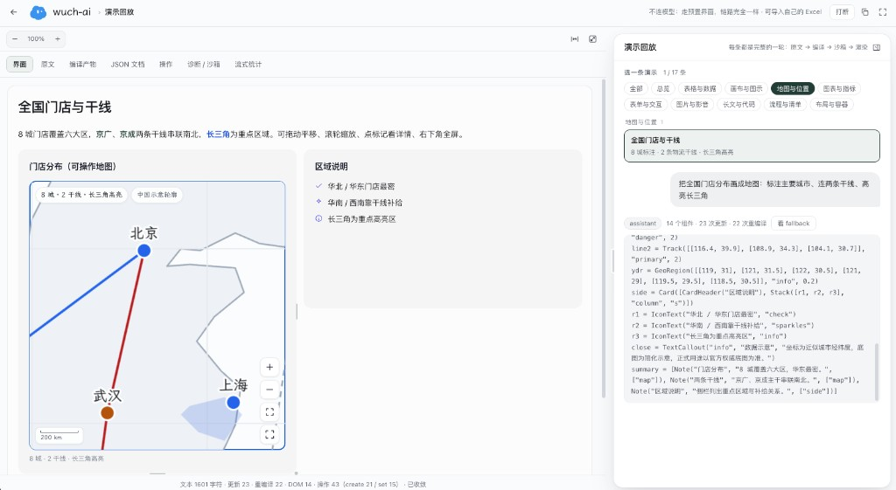
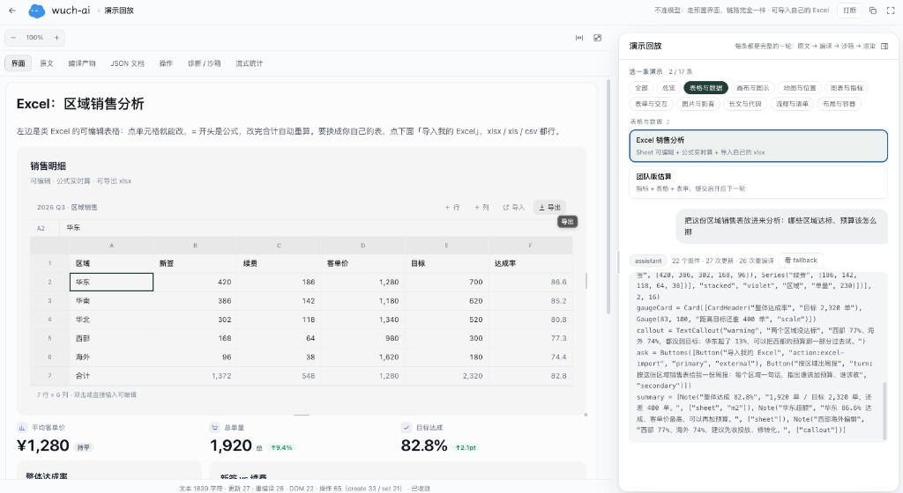

# wuch-ai

**English** | [中文](README.zh.md)

<p align="center">
  
</p>

[](https://wuch-ai.net)
[](https://wuch-ai.net/demos.html)
[](LICENSE)
[](https://bun.sh)
[](apps/cloudflare/README.md)

**Say what you want — the UI grows on the canvas.**

No drag-and-drop builder, no hand-written frontend. One message in the chat pane; the left canvas streams and renders as it goes. Sliders, checkboxes, and options update in place—no extra model round-trip. Sessions, memory, and knowledge stay on your side.

**Try it → [https://wuch-ai.net](https://wuch-ai.net)** · [Demo replay](https://wuch-ai.net/demos.html) (no model key required) · [Intro](https://wuch-ai.net/intro)

<p align="center">
  
</p>
<p align="center"><sub>Login → demo replay: Excel sales analysis / product dashboard (streamed render, canned replay—no live model)</sub></p>

## Why wuch-ai

| You get | Meaning |
|---|---|
| Natural language → interactive UI | Say “build a Q3 sales page” and charts, tables, and controls appear on the left |
| Edit in place, no extra model call | Sliders, checks, and options update locally; send another message when you need the next turn |
| Isolated cloud trial accounts | Sign up and use; sessions / memory / knowledge are per account |
| Self-hostable | `bun run dev` locally, or deploy to your own Workers |

## What it looks like

**Login.** Dedicated auth page; register or sign in before the canvas. Keep several accounts and switch anytime.



**Main UI.** Canvas on the left, chat on the right. One sentence on the right; the left streams as it renders. The top bar shows source, compile output, and diagnostics.



**Product analytics dashboard.** Ask for a product dashboard and get metrics, trend charts, and insight cards—then refine in chat.



**Maps & routes.** Demo replay works without a model: store pins, trunk lines, region highlights—same pipeline as live chat.



**Tables & Excel.** Editable sales grids; import your own sheet, then ask the chat about targets and budget.



## What you’ll use

| Entry | What it does |
|---|---|
| [wuch-ai.net](https://wuch-ai.net) | Hosted app: register, sign in, use |
| `/login` | Sign up / sign in, then enter the main UI |
| `/` | Live UI left, chat right; set model base URL and key in Settings |
| `/demos.html` | Canned UI replay without a model (maps, tables, …) |

Say something simple (e.g. “make a Q3 sales page”); the left pane streams and renders. Controls are clickable on the canvas; send another message when you need a new turn.

## Run locally

```bash
bun install
bun run dev          # http://127.0.0.1:8788
bun run mock         # optional fake upstream when you have no key: http://127.0.0.1:8789/v1
```

1. Open http://127.0.0.1:8788/login and register an account  
2. In the main UI, open Settings and fill an OpenAI-compatible base URL and API key  
3. Official APIs often hit CORS: enable local proxy in Settings, or set the base URL to  
   `http://127.0.0.1:8788/proxy?url=https://api.openai.com/v1`  
4. No key: run `bun run mock`, then use `http://127.0.0.1:8789/v1`  
5. Want a preview first: open `/demos.html` and try map or table demos  

Hosted app: [https://wuch-ai.net](https://wuch-ai.net). Cloudflare deploy notes: [`apps/cloudflare/README.md`](apps/cloudflare/README.md).

## Also available

- Multiple models and endpoints; switch from the corner of the composer  
- Images, sheets, and docs attached to the conversation  
- Knowledge distilled into entries during chat, retrieved by index later  
- Tool budgets; context can be compacted when near the limit while keeping the current UI source  
- Top-bar inspector for updates, diagnostics, and ops  

Deeper design notes live in `DESIGN.md`, `DESIGN-KB.md`, and `docs/`—you don’t need them to start.

## Links

- Product: [https://wuch-ai.net](https://wuch-ai.net)
- Intro: [https://wuch-ai.net/intro](https://wuch-ai.net/intro)
- Demos: [https://wuch-ai.net/demos.html](https://wuch-ai.net/demos.html)
- Repo: [https://github.com/CCharlie-xiu/wuch-ai](https://github.com/CCharlie-xiu/wuch-ai)
- Contributing: [CONTRIBUTING.md](CONTRIBUTING.md)
- Security: [SECURITY.md](SECURITY.md)
- Sponsor / contact: [chouxiucheng@gmail.com](mailto:chouxiucheng@gmail.com) · [Sponsor](https://github.com/sponsors/CCharlie-xiu)
- License: [MIT](LICENSE)
